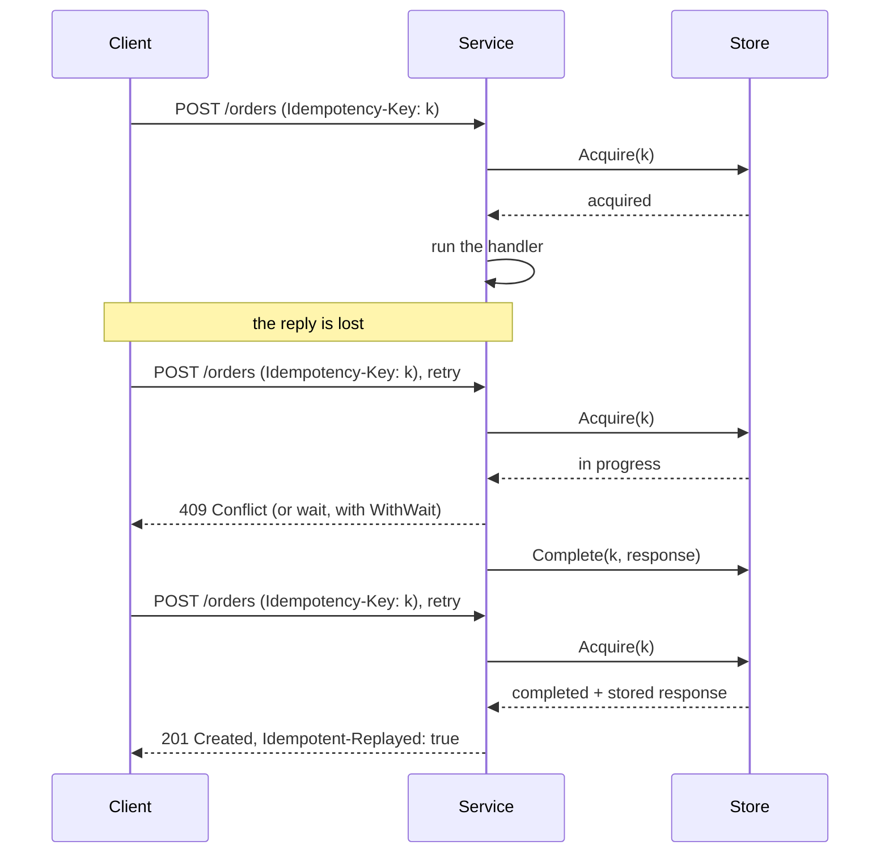

# idem

[](https://pkg.go.dev/github.com/udaykishore-resu/idem)
[](https://github.com/udaykishore-resu/idem/actions/workflows/ci.yml)
[](LICENSE)

Idempotency keys for Go. `idem` runs an operation at most once per key and
replays the stored result to every retry, so a client that times out can send
the same request again without charging a card twice.

It works for HTTP handlers, gRPC methods and any plain function, and keeps its
records in memory, Redis or PostgreSQL. The core module has no third-party
dependencies.

```go
engine := idem.New(memstore.New())

mux.Handle("POST /orders", idemhttp.Middleware(engine)(createOrder))
```

```console
$ curl -i -X POST localhost:8080/orders -H 'Idempotency-Key: demo-1' -d '{"sku":"book"}'
HTTP/1.1 201 Created
{"id":"ord_0001", ...}

$ curl -i -X POST localhost:8080/orders -H 'Idempotency-Key: demo-1' -d '{"sku":"book"}'
HTTP/1.1 201 Created
Idempotent-Replayed: true
{"id":"ord_0001", ...}
```

## What it adds

There are other idempotency middlewares for Go. This one exists for four
things:

- **Any function, not only requests.** `idem.Do` protects a queue consumer or
  a scheduled job with the same engine and store that protect your handlers.
- **Leases with heartbeats instead of fixed lock timeouts.** A key is held on
  a short lease (30 seconds by default) that is renewed while the work runs.
  A crashed process blocks retries for one lease at most, and a slow one is
  not cut off.
- **Lease tokens.** Every claim carries a random token, and the store rejects
  writes from a token that no longer holds the key. A worker that stalled
  cannot overwrite the result of the worker that took over.
- **Transactional completion on PostgreSQL.** `pgstore.DoTx` commits the
  idempotency record in the same transaction as your own writes, so the two
  can never disagree.

The core module imports only the standard library. Redis and PostgreSQL are
reached through the client you already have.

## Install

```sh
go get github.com/udaykishore-resu/idem
```

Requires Go 1.22 or later. The gRPC interceptor is a separate module, so that
only gRPC services pull in gRPC:

```sh
go get github.com/udaykishore-resu/idem/idemgrpc
```

## Packages

| Package | Purpose |
| --- | --- |
| [`idem`](https://pkg.go.dev/github.com/udaykishore-resu/idem) | The engine, `Do`, and the `Store` interface |
| [`idemhttp`](https://pkg.go.dev/github.com/udaykishore-resu/idem/idemhttp) | `net/http` middleware for the `Idempotency-Key` header |
| [`idemgrpc`](https://pkg.go.dev/github.com/udaykishore-resu/idem/idemgrpc) | Unary server interceptor (separate module) |
| [`memstore`](https://pkg.go.dev/github.com/udaykishore-resu/idem/memstore) | In-memory store for tests and single instances |
| [`redisstore`](https://pkg.go.dev/github.com/udaykishore-resu/idem/redisstore) | Redis store, through any client that can run a script |
| [`pgstore`](https://pkg.go.dev/github.com/udaykishore-resu/idem/pgstore) | PostgreSQL store through `database/sql`, with `DoTx` |
| [`storetest`](https://pkg.go.dev/github.com/udaykishore-resu/idem/storetest) | Conformance suite for your own `Store` |

## How a key behaves

```
absent ──Acquire──▶ in progress ──Complete──▶ completed ──ttl──▶ absent
                        │
                        └──Release, or the lease runs out──▶ absent
```



## Usage

### Any function

```go
receipt, replayed, err := idem.Do(ctx, engine, msg.ID,
    func(ctx context.Context) (Receipt, error) {
        return charge(ctx, msg)
    })
```

`Do` returns the stored result without calling the function if the key has
already completed. If the function returns an error or panics, nothing is
stored and the key is released, so the retry runs it again. The context passed
to the function is cancelled if the lease is lost.

For results that are not a single value, `Engine.Begin` hands you the claim
directly:

```go
attempt, stored, err := engine.Begin(ctx, key)
if err != nil {
    return err // in progress elsewhere, wrong fingerprint, or a store error
}
if attempt == nil {
    return use(stored) // already completed
}
defer attempt.Release(ctx) // does nothing once Complete has succeeded

result, err := work(attempt.Context())
if err != nil {
    return err
}
return attempt.Complete(ctx, result)
```

### HTTP

```go
idempotent := idemhttp.Middleware(engine,
    idemhttp.Scope(func(r *http.Request) string { return auth.TenantID(r.Context()) }),
    idemhttp.RequireKey(),
)
mux.Handle("POST /orders", idempotent(createOrder))
```

| Situation | Response |
| --- | --- |
| No key | Passes through, or 400 with `RequireKey` |
| First request with a key | The handler runs; its response is stored |
| Repeat of a completed request | Stored response, `Idempotent-Replayed: true` |
| Repeat while the first is running | 409 Conflict |
| Same key, different method, path, query or body | 422 Unprocessable Content |
| Malformed key, or a body that cannot be read | 400 |
| Store unreachable | 503, or pass through with `FailOpen` |

Responses are stored unless their status asks the client to retry (408, 425,
429 and every 5xx). Errors are reported as RFC 9457 problem details. The
middleware acts on POST and PATCH by default.

**Scope your keys.** Clients choose their keys, so two clients can choose the
same one. Without `Scope`, the second client receives the first client's
stored response. Bind keys to the authenticated caller and install the
middleware after authentication.

### gRPC

```go
server := grpc.NewServer(grpc.ChainUnaryInterceptor(
    idemgrpc.UnaryServerInterceptor(engine, idemgrpc.Scope(tenantFromContext)),
))
```

The key travels in the `idempotency-key` metadata entry. A repeat while the
first call is running fails with `Aborted`, a key reused for a different
request with `InvalidArgument`, and an unreachable store with `Unavailable`.
Only successful responses are stored.

### Stores

```go
// In memory: tests, examples, single instances.
engine := idem.New(memstore.New())

// Redis, with go-redis. Any client that can run EVAL works.
store := redisstore.New(redisstore.EvalFunc(
    func(ctx context.Context, script string, keys []string, args ...any) (any, error) {
        return rdb.Eval(ctx, script, keys, args...).Result()
    }))

// PostgreSQL, with whichever database/sql driver you use.
store := pgstore.New(db)
err := store.CreateTable(ctx) // or put store.Schema() in a migration
```

### Committing the record with your data

With Redis, or with `Do` on PostgreSQL, the work and the record are two
separate writes. A crash between them leaves the work done and the record
missing, and the retry repeats the work. `DoTx` removes that window:

```go
order, replayed, err := pgstore.DoTx(ctx, engine, key,
    func(ctx context.Context, tx *sql.Tx) (Order, error) {
        o := Order{ID: newID(), Total: 4200}
        _, err := tx.ExecContext(ctx,
            `INSERT INTO orders (id, total) VALUES ($1, $2)`, o.ID, o.Total)
        return o, err
    })
```

The insert and the idempotency record commit together or not at all. If the
caller lost its lease in the meantime, the transaction rolls back and the
caller that took the key over does the work instead. `DoTx` runs the
transaction at READ COMMITTED and needs a pool of at least two connections,
one for the transaction and one for the heartbeat.

### Options

| Option | Default | Meaning |
| --- | --- | --- |
| `WithLease(d)` | 30s | How long a key stays claimed without a heartbeat |
| `WithHeartbeat(d)` | lease / 3 | How often the lease is renewed; 0 turns it off |
| `WithTTL(d)` | 24h | How long a completed result is replayed |
| `WithWait(d)` | 0 | Wait this long for a running duplicate instead of failing |
| `WithFingerprint(fp)` | none | Reject a key reused for a different request |
| `WithNamespace(ns)` | none | Key prefix, so engines can share a store |
| `WithCodec(c)` | JSON | How `Do` encodes results |

## What is and is not guaranteed

While a lease is held, at most one caller runs the operation for a key. Once
it succeeds, every caller with that key gets the stored result until the
record expires.

A lease is not a transaction. A holder that cannot renew its lease, because
its process is frozen or because it cannot reach the store, loses the key when
the lease runs out, and another caller may then start the same work. The first
holder's context is cancelled as soon as it can tell, and the store refuses
its result once another caller holds the key, but whatever it already did
outside the store has happened.
`pgstore.DoTx` closes that gap for writes to the same database. For side
effects in other systems, pass the key on to them so that they deduplicate
too.

`idemhttp` reads the request body and buffers the response in memory, 1 MiB
each by default. It is meant for API calls, not for uploads or streams.

The HTTP middleware, the gRPC interceptor and `Do` each store their own kind
of record. If they share a store, give each its own engine with its own
`WithNamespace`.

The module is at v0: the API may still change before v1.0.0.

## Writing a store

Implement the four methods of `idem.Store` and run the conformance suite
against them:

```go
func TestStore(t *testing.T) {
    storetest.Run(t, func(t *testing.T) idem.Store { return mystore.New(connect(t)) })
}
```

## Development

```sh
make test          # unit tests with the race detector
make run           # start the example service on localhost:8080
make services      # start Redis and PostgreSQL with Docker Compose
make integration   # run every store against those servers, plus the gRPC tests
make tidy          # go mod tidy in all three modules
```

The repository holds three modules. The root module has no dependencies.
`idemgrpc` depends on gRPC. `integration` tests the stores with go-redis, pgx
and lib/pq against real servers and is never imported.

## Skills demonstrated

- **Distributed systems:** leases, heartbeats, ownership tokens, at-most-once
  execution, crash recovery, and an explicit statement of what cannot be
  guaranteed.
- **Go API design:** generics (`Do[T]`), functional options, small interfaces,
  context propagation and cancellation causes, a dependency-free core.
- **PostgreSQL:** atomic claim with `INSERT ... ON CONFLICT`, row-level
  locking under READ COMMITTED, transactional completion, server-side clocks.
- **Redis:** atomic Lua scripts, key expiry as lease enforcement, a
  client-agnostic adapter.
- **HTTP and gRPC:** middleware and interceptors, response buffering and
  replay, RFC 9457 problem details, the IETF Idempotency-Key draft.
- **Testing:** a reusable conformance suite checked against deliberately
  broken stores, race-detector runs, integration tests on real Redis and
  PostgreSQL, runnable documentation examples.

## Links

- [Package documentation](https://pkg.go.dev/github.com/udaykishore-resu/idem)
- [The Idempotency-Key HTTP Header Field (IETF draft)](https://datatracker.ietf.org/doc/draft-ietf-httpapi-idempotency-key-header/)
- [RFC 9457: Problem Details for HTTP APIs](https://www.rfc-editor.org/rfc/rfc9457)

## License

[MIT](LICENSE)
